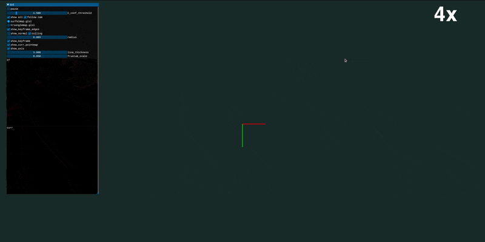

> 이 폴더는 D457 USB RGB-D와 평면 제약을 추가한 독립 복사본입니다. **[실행 방법·구현 범위·실사 검증 결과](README_PLANAR.md)**를 먼저 확인하세요. 실행: `./run_d457.sh`

> 다른 GPU 서버로 카메라 입력 전송: [RGB-D 네트워크 실행 안내](README_NETWORK_RGBD.md). 카메라 PC에서 `send_rgbd.py`, 서버에서 `run_d457.py --camera-host <카메라_PC_IP>`를 실행합니다.

[comment]: <> (# MASt3R-SLAM: Real-Time Dense SLAM with 3D Reconstruction Priors)

<p align="center">
  <h1 align="center">MASt3R-SLAM: Real-Time Dense SLAM with 3D Reconstruction Priors</h1>
  <p align="center">
    <a href="https://rmurai.co.uk/"><strong>Riku Murai*</strong></a>
    ·
    <a href="https://edexheim.github.io/"><strong>Eric Dexheimer*</strong></a>
    ·
    <a href="https://www.doc.ic.ac.uk/~ajd/"><strong>Andrew J. Davison</strong></a>
  </p>
  <p align="center">(* Equal Contribution)</p>

[comment]: <> (  <h2 align="center">PAPER</h2>)
  <h3 align="center"><a href="https://arxiv.org/abs/2412.12392">Paper</a> | <a href="https://youtu.be/wozt71NBFTQ">Video</a> | <a href="https://edexheim.github.io/mast3r-slam/">Project Page</a></h3>
  <div align="center"></div>

<p align="center">
    
</p>
<br>

# Getting Started
## Installation
```
conda create -n mast3r-slam python=3.11
conda activate mast3r-slam
```
Check the system's CUDA version with nvcc
```
nvcc --version
```
Install pytorch with **matching** CUDA version following:
```
# CUDA 11.8
conda install pytorch==2.5.1 torchvision==0.20.1 torchaudio==2.5.1  pytorch-cuda=11.8 -c pytorch -c nvidia
# CUDA 12.1
conda install pytorch==2.5.1 torchvision==0.20.1 torchaudio==2.5.1 pytorch-cuda=12.1 -c pytorch -c nvidia
# CUDA 12.4
conda install pytorch==2.5.1 torchvision==0.20.1 torchaudio==2.5.1 pytorch-cuda=12.4 -c pytorch -c nvidia
```

Clone the repo and install the dependencies.
```
git clone https://github.com/rmurai0610/MASt3R-SLAM.git --recursive
cd MASt3R-SLAM/

# if you've clone the repo without --recursive run
# git submodule update --init --recursive

pip install -e thirdparty/mast3r
pip install -e thirdparty/in3d
pip install --no-build-isolation -e .
 

# Optionally install torchcodec for faster mp4 loading
pip install torchcodec==0.1
```

Setup the checkpoints for MASt3R and retrieval.  The license for the checkpoints and more information on the datasets used is written [here](https://github.com/naver/mast3r/blob/mast3r_sfm/CHECKPOINTS_NOTICE).
```
mkdir -p checkpoints/
wget https://download.europe.naverlabs.com/ComputerVision/MASt3R/MASt3R_ViTLarge_BaseDecoder_512_catmlpdpt_metric.pth -P checkpoints/
wget https://download.europe.naverlabs.com/ComputerVision/MASt3R/MASt3R_ViTLarge_BaseDecoder_512_catmlpdpt_metric_retrieval_trainingfree.pth -P checkpoints/
wget https://download.europe.naverlabs.com/ComputerVision/MASt3R/MASt3R_ViTLarge_BaseDecoder_512_catmlpdpt_metric_retrieval_codebook.pkl -P checkpoints/
```

## WSL Users
We have primarily tested on Ubuntu.  If you are using WSL, please checkout to the windows branch and follow the above installation.
```
git checkout windows
```
This disables multiprocessing which causes an issue with shared memory as discussed [here](https://github.com/rmurai0610/MASt3R-SLAM/issues/21).

## Examples
```
bash ./scripts/download_tum.sh
python main.py --dataset datasets/tum/rgbd_dataset_freiburg1_room/ --config config/calib.yaml
```
## Live Demo
Connect a realsense camera to the PC and run
```
python main.py --dataset realsense --config config/base.yaml
```
For RGB images published over ROS 2, run the receiver in a ROS 2 terminal:
```
/usr/bin/python3 scripts/ros2_rgb_receiver.py
```
It subscribes to `/camera/color/image_raw` and `/camera/color/camera_info`.
Then, in the `mast3r-slam` environment, run:
```
python main.py --dataset ros2 --config config/base.yaml
```
Use `--config config/calib.yaml` to use the camera intrinsics received from ROS 2.

For short runs on an 8 GB GPU, reduce preallocated keyframe storage:
```
python main.py --dataset ros2 --config config/low_memory.yaml
```
This configuration keeps the model input resolution and stops mapping when 64
keyframes are stored; close the visualization window to exit. Increase
`keyframes.buffer` in the configuration to map longer sequences
if GPU memory permits. To use ROS 2 camera intrinsics with this profile, also set
`use_calib: True` in `config/low_memory.yaml`.

For a Go2-mounted D435i, `config/go2_ros.yaml` combines the 64-keyframe storage
limit with the camera intrinsics forwarded by the ROS 2 receiver:
```
python main.py --dataset ros2 --config config/go2_ros.yaml
```

## Running on a video
Our system can process either MP4 videos or folders containing RGB images.
```
python main.py --dataset <path/to/video>.mp4 --config config/base.yaml
python main.py --dataset <path/to/folder> --config config/base.yaml
```
If the calibration parameters are known, you can specify them in intrinsics.yaml
```
python main.py --dataset <path/to/video>.mp4 --config config/base.yaml --calib config/intrinsics.yaml
python main.py --dataset <path/to/folder> --config config/base.yaml --calib config/intrinsics.yaml
```

## Downloading Dataset
### TUM-RGBD Dataset
```
bash ./scripts/download_tum.sh
```

### 7-Scenes Dataset
```
bash ./scripts/download_7_scenes.sh
```

### EuRoC Dataset
```
bash ./scripts/download_euroc.sh
```
### ETH3D SLAM Dataset
```
bash ./scripts/download_eth3d.sh
```

## Running Evaluations
All evaluation script will run our system in a single-threaded, headless mode.
We can run evaluations with/without calibration:
### TUM-RGBD Dataset
```
bash ./scripts/eval_tum.sh 
bash ./scripts/eval_tum.sh --no-calib
```

### 7-Scenes Dataset
```
bash ./scripts/eval_7_scenes.sh 
bash ./scripts/eval_7_scenes.sh --no-calib
```

### EuRoC Dataset
```
bash ./scripts/eval_euroc.sh 
bash ./scripts/eval_euroc.sh --no-calib
```
### ETH3D SLAM Dataset
```
bash ./scripts/eval_eth3d.sh 
```

## Reproducibility
There might be minor differences between the released version and the results in the paper after developing this multi-processing version. 
We run all our experiments on an RTX 4090, and the performance may differ when running with a different GPU.

## Acknowledgement
We sincerely thank the developers and contributors of the many open-source projects that our code is built upon.
- [MASt3R](https://github.com/naver/mast3r)
- [MASt3R-SfM](https://github.com/naver/mast3r/tree/mast3r_sfm)
- [DROID-SLAM](https://github.com/princeton-vl/DROID-SLAM)
- [ModernGL](https://github.com/moderngl/moderngl)

# Citation
If you found this code/work to be useful in your own research, please considering citing the following:

```bibtex
@article{murai2024_mast3rslam,
    title={{MASt3R-SLAM}: Real-Time Dense {SLAM} with {3D} Reconstruction Priors},
    author={Murai, Riku and Dexheimer, Eric and Davison, Andrew J.},
    journal={arXiv preprint},
    year={2024},
}      
```
